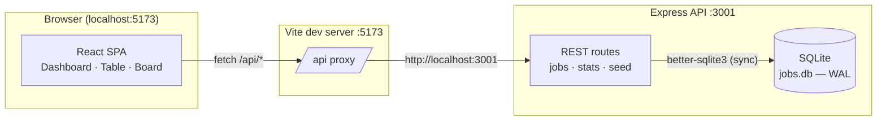
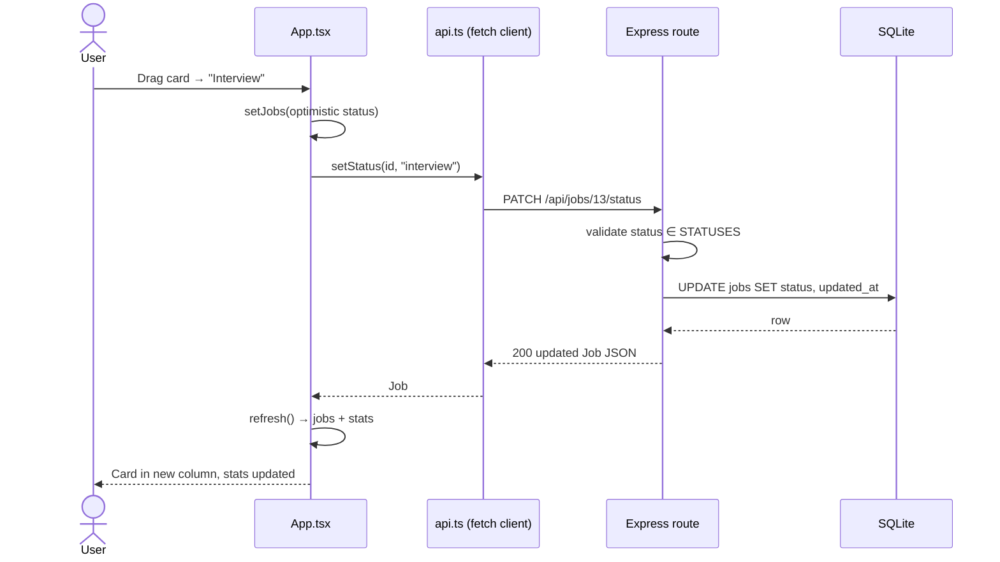
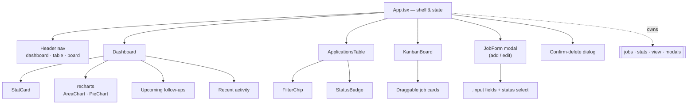
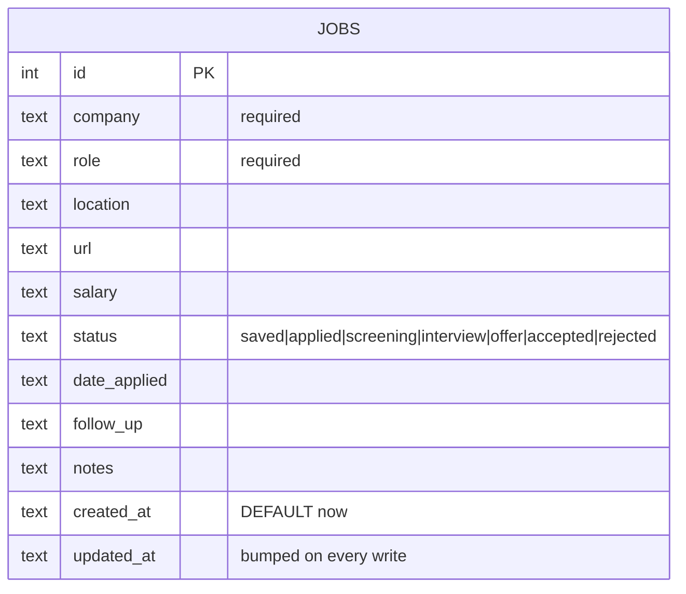
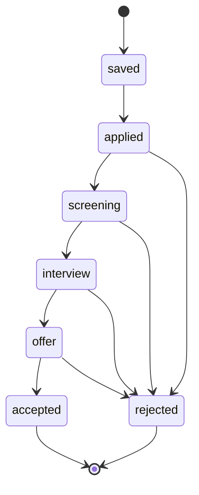

# JobFlow — Architecture

Technical overview of the job application tracker: system layout, request flow, data model, and component structure.

## 1. Design goals

| Goal | How it's met |
| --- | --- |
| Zero-config persistence | SQLite file (`jobs.db`) created on first run — no DB server to install |
| Instant feedback | Optimistic status updates on the kanban; server confirms in the background |
| Single-command dev | `npm run dev:all` runs API + frontend together |
| One source of truth | `STATUSES` + `STATUS_META` define every stage's label/colors for server and UI |
| Typed end-to-end | Shared `Job`/`Status`/`Stats` shapes mirrored between `server/db.ts` and `src/types.ts` |

## 2. System overview



Two processes, one origin: the Vite dev server proxies `/api/*` to Express, so the SPA never deals with CORS or port juggling. In production the same split applies — serve `dist/` statically and run the API alongside.

## 3. Request lifecycle



Write paths always return the **updated row**, and `App.refresh()` then re-fetches `/api/jobs` + `/api/stats` in parallel — so every mutation automatically re-renders all three views with consistent data.

## 4. Frontend component tree



`App.tsx` is the only stateful shell: it owns `jobs`, `stats`, the active view, and modal state, and passes callbacks (`onEdit`, `onDelete`, `onStatusChange`, `onSave`) down. Child components are presentation + local UI state only (search text, drag target, sort direction).

## 5. Data model



Status is a single `TEXT` column validated against `STATUSES` — no enum tables or joins. `/api/stats` derives everything (counts, response rate, weekly cadence, follow-ups due) by scanning the table, which is trivial at this scale and keeps writes simple.

## 6. State machine per application



The UI doesn't enforce transitions — any status can move to any other (drag anywhere on the board) — but the canonical funnel above is what the dashboard's conversion metrics assume.

## 7. Rendering & styling

- **Tailwind CSS v4** via `@tailwindcss/vite` — theme tokens (`--color-ink`, `--color-panel`, `--color-acc`, …) declared once in `index.css` under `@theme`, consumed as `var(--color-*)` in the `.card` / `.input` / `.btn` component classes and inline status colors.
- **Status visuals** are data-driven: `STATUS_META[status]` supplies `label`, `color`, `bg`, `dot` — badges, kanban column headers, donut segments, and filter chips all read the same map.
- **Drag & drop** uses native HTML5 DnD — card `draggable`, columns handle `dragover`/`drop`, a `dragId` state dims the dragged card and highlights the hovered column. No library needed.
- **Charts** are `recharts` `ResponsiveContainer`s sized to their parent cards.

## 8. API surface

| Method | Route | Validation | Returns |
| --- | --- | --- | --- |
| GET | `/api/jobs?status=&q=` | `status` must be in `STATUSES`; `q` LIKE-matches company/role/location | `Job[]` |
| POST | `/api/jobs` | `company` + `role` required; `status` validated | `201 Job` |
| PUT | `/api/jobs/:id` | merges body over existing row; validates same rules | `Job` |
| PATCH | `/api/jobs/:id/status` | `status` ∈ `STATUSES` | `Job` |
| DELETE | `/api/jobs/:id` | — | `{ok}` |
| GET | `/api/stats` | — | `Stats` aggregate |
| POST | `/api/seed` | only when table is empty (`409` otherwise) | `{inserted}` |

All endpoints return the canonical row after writing, so the client never guesses about defaults (e.g. `date_applied` falls back to today server-side).

## 9. Extension points

- **New pipeline stage**: add to `STATUSES` in `server/db.ts` + `src/types.ts` and a `STATUS_META` entry — table chips, board columns, donut, and form select pick it up automatically.
- **User accounts / multi-user**: add a `user_id` column + auth middleware; the API is already session-agnostic REST.
- **Browser extension capture**: the POST endpoint accepts any payload, so an extension can send `{company, role, url}` scraped from a job board.
- **Reminders**: `follow_up` is already stored — a cron/`setInterval` in `server/index.ts` can push due items to email/Slack.

## 10. Local topology

```
Browser ──► vite :5173 ──/api──► express :3001 ──► jobs.db (file)
```

- Frontend: `npm run dev` (Vite, HMR)
- Backend: `npm run server` (tsx watch — auto-restarts on `server/` edits)
- Both: `npm run dev:all` (concurrently)
- Production: `npm run build` → static `dist/`; run the same `server/index.ts` with `tsx` or compiled Node.
