# JobFlow — Architecture

Comprehensive technical reference for the job application tracker: system layout, module graph, request flows, data model, state management, and design decisions.

## Contents

1. [Design goals](#1-design-goals)
2. [System overview](#2-system-overview)
3. [Module dependency graph](#3-module-dependency-graph)
4. [Request lifecycles](#4-request-lifecycles)
5. [Frontend component tree](#5-frontend-component-tree)
6. [State ownership model](#6-state-ownership-model)
7. [Data model](#7-data-model)
8. [Stats computation pipeline](#8-stats-computation-pipeline)
9. [Status state machine](#9-status-state-machine)
10. [Styling & design system](#10-styling--design-system)
11. [API surface](#11-api-surface)
12. [Error handling & edge cases](#12-error-handling--edge-cases)
13. [Deployment topology](#13-deployment-topology)
14. [Extension points](#14-extension-points)
15. [Design decisions log](#15-design-decisions-log)

---

## 1. Design goals

| Goal | How it's met |
| --- | --- |
| Zero-config persistence | SQLite file (`jobs.db`) created on first run — no DB server to install |
| Instant feedback | Optimistic status updates on the kanban; server confirms in the background |
| Single-command dev | `npm run dev:all` runs API + frontend together via `concurrently` |
| One source of truth | `STATUSES` + `STATUS_META` define every stage's label/colors for server and UI |
| Typed end-to-end | `Job`/`Status`/`Stats` shapes mirrored between `server/db.ts` and `src/types.ts` |
| No framework lock-in | Plain REST + React — API consumable by any client (CLI, extension, mobile) |
| Small runtime surface | No ORM, no DnD library, no state library — deps are `express`, `better-sqlite3`, `react`, `recharts`, `lucide-react` |

## 2. System overview

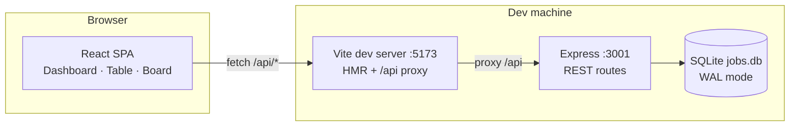

Two processes, one origin: the Vite dev server proxies `/api/*` to Express, so the SPA never deals with CORS or port juggling. `better-sqlite3` is synchronous — every route is a straight-line prepared statement, no connection pooling needed for a single-file DB.

### Runtime vs build-time

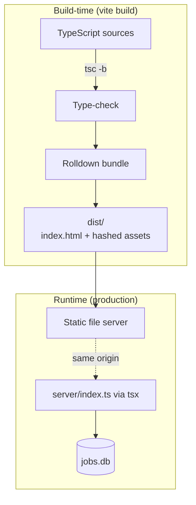

The frontend compiles to a static bundle; the backend ships as plain TS run under `tsx` — no transpile step for the server, keeping dev and prod on identical code.

## 3. Module dependency graph

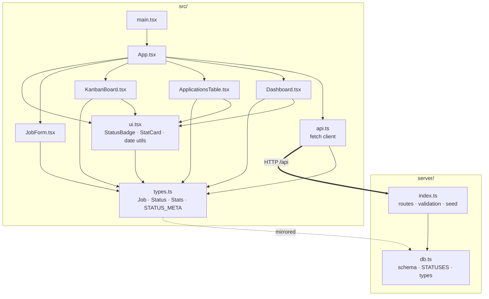

Key property: **the dependency graph is a tree, not a web** — every component imports `types.ts`, only `App.tsx` imports `api.ts`, and nothing imports a sibling component. That keeps the render path obvious and prevents circular imports.

## 4. Request lifecycles

### 4a. Page load

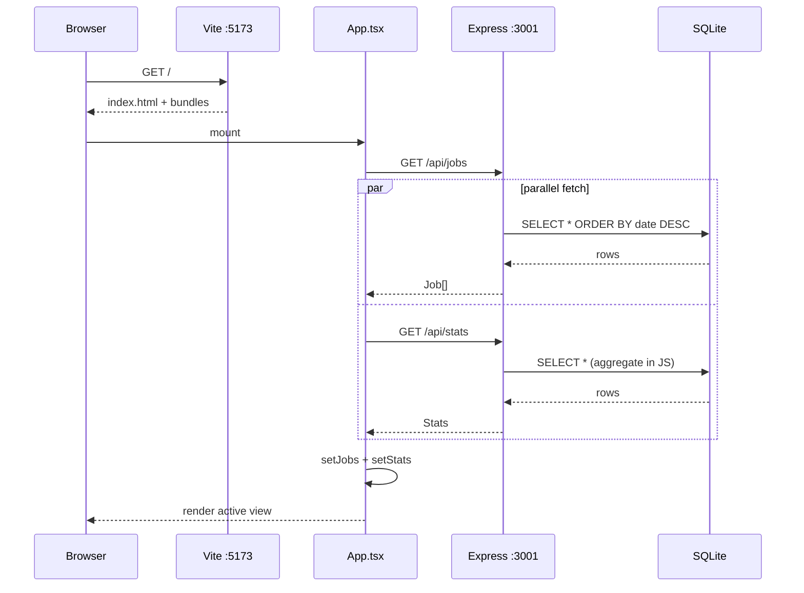

### 4b. Create application

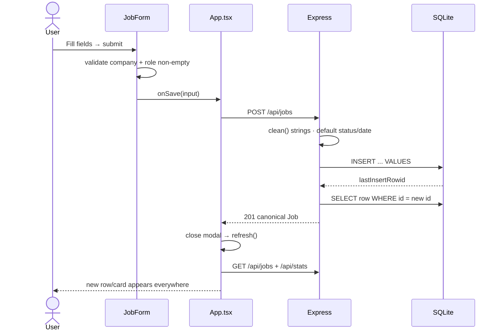

### 4c. Kanban drag & drop

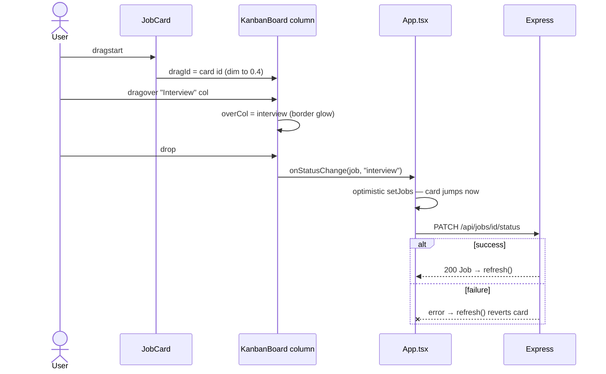

If the PATCH fails, `refresh()` re-fetches server truth and the card animates back — no bespoke rollback logic needed.

## 5. Frontend component tree

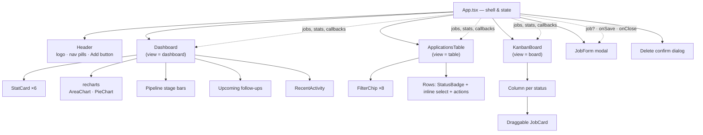

`App.tsx` is the only stateful shell — children are pure views + local UI state (search text, drag target, sort direction). Callbacks flow down: `onEdit`, `onDelete`, `onStatusChange`, `onSave`.

## 6. State ownership model

```mermaid
flowchart LR
    subgraph Server["Server = source of truth"]
        DB[(jobs table)]
    end
    subgraph Client["Client state (App.tsx)"]
        J["jobs: Job[]<br/>server snapshot"]
        S["stats: Stats<br/>server snapshot"]
        V["view: dashboard|table|board"]
        M["modals: editing · confirmDelete"]
    end
    subgraph Local["Per-component local state"]
        L1["Table: q · statusFilter · sortAsc"]
        L2["Board: dragId · overCol"]
        L3["Form: form · busy · error"]
    end
    DB -->|refresh()| J
    DB -->|refresh()| S
    J -->|filter| L1
    J -->|groupBy status| L2
```

- **Server-owned**: every `Job` field — the client never invents values; writes round-trip and re-fetch.
- **App-owned**: view selection, modal targets, the `jobs`/`stats` snapshots — lifted because all three views share them.
- **Component-owned**: ephemeral UI (search text, sort, drag hover) — lives and dies with the view.

This split is why the app needs no Redux/Zustand: shared state is exactly two snapshots refreshed after each mutation.

## 7. Data model

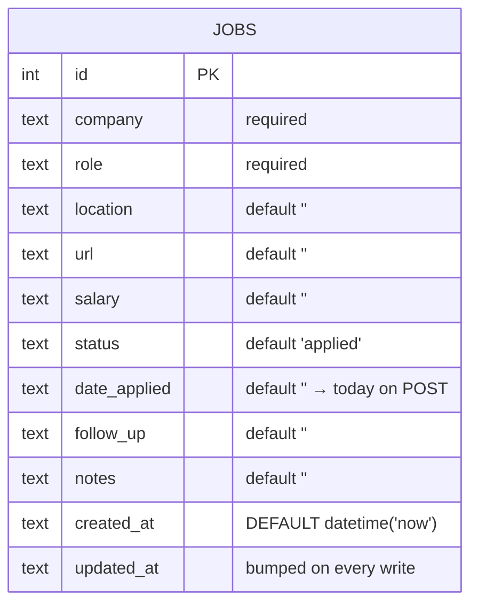

Status is a `TEXT` column validated in the route against `STATUSES` — no enum table or joins. Every field except `id`/`company`/`role` is optional, keeping the capture form frictionless.

## 8. Stats computation pipeline

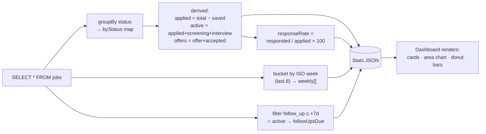

All aggregation runs in JS over one table scan — trivially fast at personal-scale data (<10k rows), and it means stats can never drift out of sync with the data: there are no counters to maintain.

## 9. Status state machine

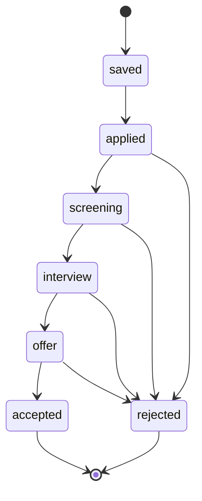

The UI doesn't enforce transitions — any card can move anywhere (real job hunts are messy) — but the canonical funnel above is what conversion metrics assume. `saved` is deliberately outside the pipeline: it represents intent, not progress.

## 10. Styling & design system

- **Tailwind CSS v4** via `@tailwindcss/vite` — zero config file; theme tokens (`--color-ink`, `--color-panel`, `--color-edge`, `--color-acc`…) declared once in `index.css` under `@theme`.
- **Component classes**: `.card` (panel surface), `.input`, `.btn` (+`-primary`/`-ghost`/`-danger` variants) — semantic primitives reused by every view.
- **Status visuals are data-driven**: `STATUS_META[status]` supplies `label`, `color`, `bg`, `dot` — badges, kanban headers, donut segments, filter chips all read the same map, so a stage recolor is one line.
- **Drag & drop**: native HTML5 DnD — `draggable` cards, `dragover`/`drop` on columns, `dragId` dims the source and `overCol` glows the target. No library.
- **Charts**: `recharts` `ResponsiveContainer`s sized to parent cards; dark grid strokes read the same theme tokens.

## 11. API surface

| Method | Route | Validation | Returns |
| --- | --- | --- | --- |
| GET | `/api/jobs?status=&q=` | `status` ∈ `STATUSES`; `q` LIKE-matches company/role/location | `Job[]` |
| POST | `/api/jobs` | `company` + `role` required; `status` validated; `date_applied` defaults to today | `201 Job` |
| PUT | `/api/jobs/:id` | merges body over existing row; same rules | `Job` |
| PATCH | `/api/jobs/:id/status` | `status` ∈ `STATUSES` | `Job` |
| DELETE | `/api/jobs/:id` | 404 if absent | `{ok}` |
| GET | `/api/stats` | — | `Stats` aggregate |
| POST | `/api/seed` | only when table is empty (`409` otherwise) | `{inserted}` |

All write endpoints return the canonical row after writing, so the client never guesses about server-side defaults.

## 12. Error handling & edge cases

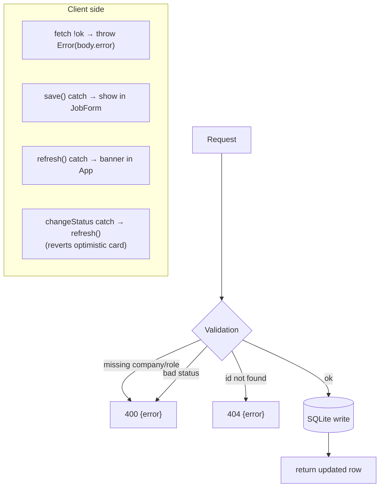

- **Optimistic-update failure**: kanban moves revert silently via `refresh()` — server truth wins.
- **Seed idempotence**: `POST /api/seed` refuses non-empty tables (`409`), so it can't duplicate.
- **Missing API**: the SPA shows an inline banner (`npm run server` hint) instead of a blank page.
- **Overdue follow-ups**: computed at render time (`follow_up ≤ today` + active status) — no scheduler needed.
- **`updated_at` ordering** powers Recent Activity — bumped by SQL on every UPDATE.

## 13. Deployment topology

### Dev (this project today)

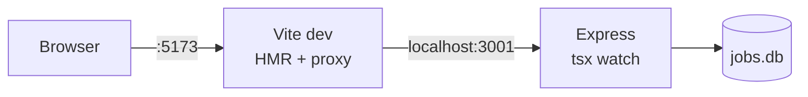

### Production (suggested)

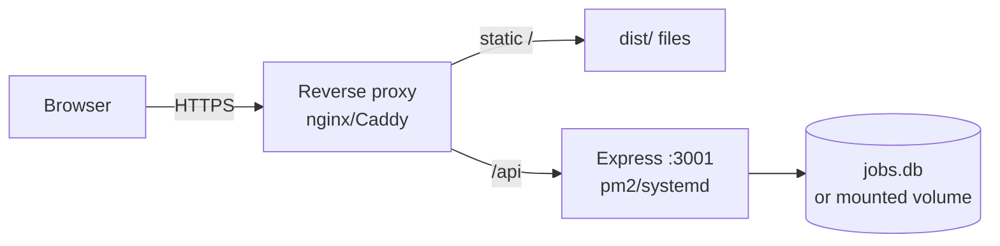

Same-process-per-origin in both modes: the SPA only ever calls relative `/api/*`, so deployment shape (subpath, domain, or LAN) is purely an ops concern.

## 14. Extension points

- **New pipeline stage**: add to `STATUSES` in `server/db.ts` + `src/types.ts` and a `STATUS_META` entry — table chips, board columns, donut, and form select pick it up automatically.
- **User accounts / multi-user**: add a `user_id` column + auth middleware; the API is already session-agnostic REST.
- **Browser extension capture**: the POST endpoint accepts any payload, so an extension can send `{company, role, url}` scraped from a job board.
- **Reminders**: `follow_up` is already stored — a cron/`setInterval` in `server/index.ts` can push due items to email/Slack.
- **Richer model**: tags, documents (resume versions), or interview rounds fit naturally as extra columns or a second table joined on `job_id`.
- **Bulk import**: CSV/LinkedIn export → loop over `POST /api/jobs`.

## 15. Design decisions log

| Decision | Chosen | Alternative rejected | Why |
| --- | --- | --- | --- |
| DB engine | SQLite via `better-sqlite3` | Postgres / JSON file | Zero-install, sync API keeps routes trivial; JSON loses transactions |
| ORM | None — prepared statements | Prisma / Drizzle | Schema is 1 table; an ORM adds codegen + migration machinery for zero benefit here |
| Server validation | Hand-rolled `clean()` + `STATUSES` check | zod / joi | 9 string fields — a schema lib is heavier than the problem |
| Client state | React state in `App.tsx` + refetch-after-write | React Query / Zustand | Shared state is two snapshots; a library would mainly cache what refetch already gives |
| DnD | Native HTML5 | dnd-kit / react-beautiful-dnd | Kanban needs drag + column drop only; native covers it with no bundle cost |
| UI kit | Hand-rolled on Tailwind tokens | shadcn / MUI | 3 views; a component lib would be 90% unused surface |
| Charts | recharts | Chart.js / visx | React-native API, themeable, small |
| Server language | TypeScript under `tsx` | Compiled JS / separate tsconfig | Same language both sides; tsx skips a build step for a 200-line server |
| Status storage | `TEXT` + app-level enum | SQL CHECK / enum type | SQLite has no enums; CHECK would also work but duplicating `STATUSES` in SQL adds a second truth to maintain |
